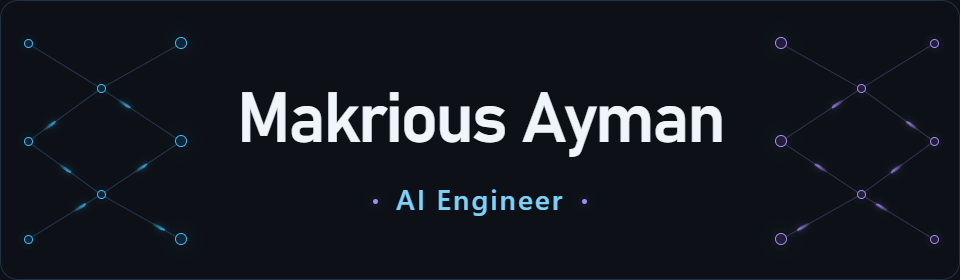

<!-- ======================== INTRO ======================== -->
<div align="center">

<picture>
  <source media="(prefers-reduced-motion: reduce)" srcset="./assets/neural-header.png">
  
</picture>

### Machine Learning · Deep Learning · Generative AI

<picture>
  <source media="(prefers-reduced-motion: reduce)" srcset="https://img.shields.io/badge/Curiosity_driven._Problem_solving_focused.-1A1B27?style=for-the-badge&amp;color=1A1B27">
  
</picture>

[](https://www.linkedin.com/in/makrious-ayman-84985621b/) [](mailto:maaakrious2004@gmail.com) [](https://github.com/MakCoder-2004)

**Curious about intelligence. Serious about engineering.**

</div>

---

<!-- ======================== ABOUT ======================== -->
## 👋 A little about me

I'm **Makrious Ayman**, an **AI Engineer** driven by curiosity and a love for solving difficult problems. I'm fascinated by how machines **learn from data, understand language, and make sense of the visual world**.

My interests bring together **machine learning, deep learning, computer vision, and generative AI**. I enjoy understanding the ideas behind a model just as much as figuring out how to make it useful outside a notebook.

- 🧠 **My focus:** intelligent systems that connect data, models, and software.
- 👁️ **What fascinates me:** visual understanding, language, and the reasoning behind an answer.
- 🧩 **My foundation:** algorithms, data structures, and a competitive-programming mindset.
- ⚡ **What keeps me going:** a difficult question, a new idea, and the chance to understand something better.

```yaml
name: Makrious Ayman
role: AI Engineer
focus:
  - Machine Learning & Deep Learning
  - Generative AI
interests:
  - Computer Vision & NLP
  - LLMs, RAG & AI Agents
mindset: Stay curious. Keep improving.
```

<!-- ======================== INTERESTS ======================== -->
## 🔭 What I'm exploring

### 🤖 Generative AI & language

LLMs, retrieval-augmented generation, AI agents, and more reliable ways to connect models with knowledge.

### 👁️ Computer vision & deep learning

Image understanding, detection, neural networks, and the patterns hidden in visual data.

### ⚙️ The engineering around AI

Model evaluation, efficient pipelines, APIs, deployment, and the software that brings everything together.

---

<!-- ======================== TECH STACK ======================== -->
## 🧰 My toolkit

<div align="center">

<picture>
  <source media="(prefers-reduced-motion: reduce)" srcset="https://skillicons.dev/icons?i=python&amp;theme=dark">
  
</picture>
&nbsp;&nbsp;&nbsp;
<picture>
  <source media="(prefers-reduced-motion: reduce)" srcset="https://skillicons.dev/icons?i=docker&amp;theme=dark">
  
</picture>

### Languages


### AI frameworks · machine learning · vision


### LLMs · agents · orchestration

 

   

### Applications · data · deployment


</div>

---

<!-- ======================== GITHUB ======================== -->
## 📊 My GitHub pulse

<div align="center">


<picture>
  <source media="(prefers-reduced-motion: reduce)" srcset="https://streak-stats.demolab.com?user=MakCoder-2004&amp;theme=tokyonight&amp;hide_border=true&amp;disable_animations=true">
  
</picture>

</div>

---

<!-- ======================== CONNECT ======================== -->
<div align="center">

### Let's talk AI, exchange ideas, and make something meaningful.

I'm open to **AI engineering opportunities**, thoughtful conversations, and collaborations with people who love solving problems.

[](https://www.linkedin.com/in/makrious-ayman-84985621b/) [](mailto:maaakrious2004@gmail.com)

**Thanks for stopping by. Stay curious. ✨**

</div>
