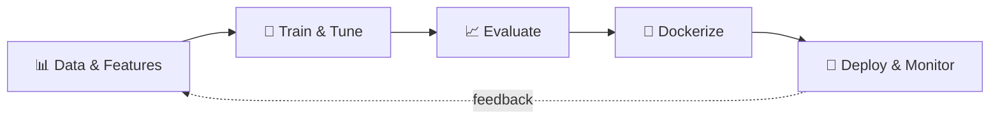

<!-- ═══════════════ HEADER ═══════════════ -->


<p align="center">
  <a href="https://git.io/typing-svg">
    
  </a>
</p>

<p align="center">
  
  
  
</p>

---

## 👋 About Me

```python
class MakriousAyman:
    def __init__(self):
        self.role      = "AI/ML Engineer & Data Science student"
        self.location  = "Alexandria, Egypt 🇪🇬"
        self.education = "B.Sc. Data Science @ Alexandria University"
        self.focus     = ["Deep Learning", "Computer Vision", "NLP", "MLOps", "RAG & AI Agents"]
        self.superpower = "Competitive-programming mindset → fast, clean, scalable ML"
        self.building  = [
            "Multimodal RAG for research papers",
            "Natural-language → SQL analytics platform",
            "Agentic software-development workflows",
        ]

    def philosophy(self):
        return "A model that never leaves the notebook solves nothing."
```

I build machine-learning systems end to end, from **raw data** to **deployed product**, and I lean on a competitive-programming background to keep everything efficient and maintainable.

---

## 🔄 How I Build ML Systems



---

## 🛠️ Tech Arsenal

<p align="center">
  
</p>

<p align="center">
  
</p>

<p align="center">
  
  
  
  
  
  
</p>

<details>
<summary><b>🧩 Core expertise (click to expand)</b></summary>
<br>

| Area | What I do |
|------|-----------|
| 🧠 **Deep Learning** | CNNs, transfer learning, model optimization |
| 👁️ **Computer Vision** | Detection, classification, segmentation, tracking, OCR, face recognition |
| 💬 **NLP & RAG** | Transformers, HuggingFace, multimodal retrieval with citations |
| 🚢 **MLOps** | Docker, REST APIs, Streamlit/Django apps, Azure ML |
| ⚡ **Algorithms** | Data structures, problem solving, performance-minded code |

</details>

---

## 🚀 Featured Projects

| Project | What it does | Stack |
|---------|--------------|-------|
| 🤖 [**maks-agentic-workflow**](https://github.com/MakCoder-2004/maks-agentic-workflow) | Plan, build and review software with AI agents using a small, carefully curated set of skills | `JavaScript` |
| 📄 [**ATS-CV-Creator**](https://github.com/MakCoder-2004/ATS-CV-Creator) | Local-first Windows CV workbench with source-backed review and PDF/Word export | `TypeScript` |
| 👁️ [**Computer-Vision-Projects**](https://github.com/MakCoder-2004/Computer-Vision-Projects) | Detection, classification, segmentation, tracking, OCR and face recognition | `Jupyter` `OpenCV` |
| 🗄️ [**Natural-Language-to-SQL**](https://github.com/MakCoder-2004/Natural-Language-to-SQL) | Ask PostgreSQL questions in plain English, review the generated SQL, get grounded answers | `Python` |
| 🔬 [**Research-paper-Multimodal-RAG**](https://github.com/MakCoder-2004/Research-paper-Multimodal-RAG) | Ingests PDFs (text, tables, figures) and answers with citations linked to source pages | `Python` |

---

## 📊 GitHub Stats

<p align="center">
  
  
</p>

<p align="center">
  
</p>

<!-- 🏆 COMPETITIVE PROGRAMMING: replace YOUR_HANDLE and uncomment
<p align="center">
  
</p>
-->

---

## 🎓 Education & Training

- 🎓 **B.Sc. in Data Science (Computer Science)**, Alexandria University
- 📘 **Machine Learning Trainee**, National Telecommunication Institute (120+ hours: ML foundations, deep learning, practical applications)
- 🏆 **Competitive Programming Trainee**, Coach Academy (DSA foundations and analytical problem solving)

## 🏅 Certifications


---

## 🤝 Let's Build Something Impactful

I'm open to opportunities in **Machine Learning Engineering**, **AI Research & Development**, **Computer Vision / NLP**, **MLOps** and **Software Engineering**.

<p align="center">
  <a href="https://www.linkedin.com/in/makrious-ayman-84985621b/">
    
  </a>
  <a href="mailto:maaakrious2004@gmail.com">
    
  </a>
  <a href="https://github.com/MakCoder-2004">
    
  </a>
</p>

<!-- ═══════════════ FOOTER ═══════════════ -->

