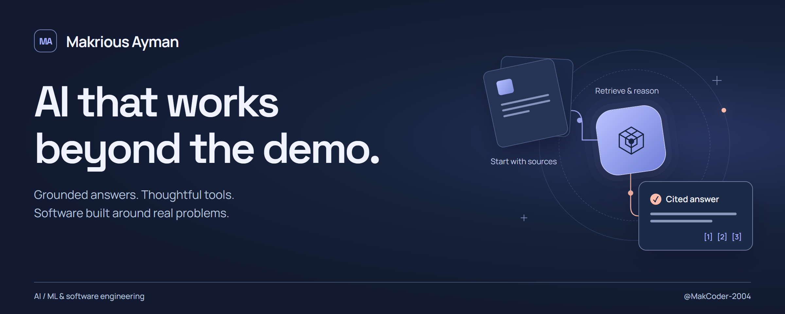
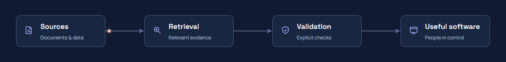

<picture>
  <source media="(max-width: 600px)" srcset="./assets/hero-mobile.png">
  
</picture>

  
  
  

I'm **Makrious**, an **AI / ML Software Engineer** building applications that connect models, data, and useful interfaces. My work spans **multimodal RAG, computer vision, and AI-powered developer tools**, with Python and TypeScript connecting the pieces.

I care about what happens after a model responds: **Can you trace the answer? Inspect the query? Review the changes?** That's where much of my engineering work lives.

<picture>
  <source media="(max-width: 600px)" srcset="./assets/pipeline-mobile.png">
  <source media="(prefers-reduced-motion: reduce)" srcset="./assets/pipeline.png">
  
</picture>

## Selected work

### [Multimodal Research RAG](https://github.com/MakCoder-2004/Research-paper-Multimodal-RAG)

Research PDFs become searchable text, tables, and figures. Answers link back to **supporting evidence and source pages**, so you can inspect what the model used.

Python / FastAPI / LangChain / Chroma / PostgreSQL / React

### [Natural Language to SQL](https://github.com/MakCoder-2004/Natural-Language-to-SQL)

Ask a question, inspect the SQL, and explore your data. Schema-aware generation meets **deterministic validation, query review, and read-only execution**.

Python / FastAPI / PostgreSQL / pgvector / React

### [CV Tailor](https://github.com/MakCoder-2004/ATS-CV-Creator)

A **local-first Windows CV workbench** with source-linked wording, explicit approval before model runs, and PDF/Word export. You review the content before it leaves the workspace or becomes a document.

Electron / React / TypeScript / SQLite / Pi SDK

### Developer tools & experiments

- **[My Pi Setup](https://github.com/MakCoder-2004/pi-maks-version)** — a sanitized coding-agent setup with custom memory and workflow extensions, Windows fixes, and an inventory of upstream tools.
- **[Maks Agentic Workflow](https://github.com/MakCoder-2004/maks-agentic-workflow)** — a curated workflow connecting existing upstream planning, implementation, review, and release skills, with attribution preserved.
- **[Webcam Image Classifier](https://github.com/MakCoder-2004/Training-And-Predicting-Real-Time-Captures-on-Web)** — train and test an image classifier in the browser using your webcam, with live predictions and model export.

## How I build

- **Evidence before confidence.** Ground answers in sources and make the supporting context inspectable.
- **Models propose; software checks.** Use explicit validation, permissions, and human review where they matter.
- **Local-first, not privacy by slogan.** Keep workspace data local where practical and make external model calls explicit.
- **Useful from end to end.** Build the data pipeline, API, and interface—not just the notebook.

## Tools I work with

| Area | Technologies |
| :--- | :--- |
| **Languages** | Python, TypeScript, JavaScript, C++, SQL |
| **AI & retrieval** | LangChain, Hugging Face, Chroma, pgvector, TensorFlow, scikit-learn |
| **Vision & data** | OpenCV, YOLO, Docling, Pandas, NumPy |
| **Applications** | React, Next.js, Electron, FastAPI, REST APIs |
| **Storage & tooling** | PostgreSQL, SQLite, Redis, Docker, Git, GitHub |

## Notes worth sharing

I turn what I explore into practical references, code, and project collections:

- **[AI Engineering](https://github.com/MakCoder-2004/AI-Engineering-Sheet)** — transformers, LLMs, RAG, agents, and deployment.
- **[Machine Learning](https://github.com/MakCoder-2004/Machine-Learning-Engineering-Sheet)** — foundations, workflows, and hands-on implementations.
- **[Computer Vision](https://github.com/MakCoder-2004/Computer-Vision-Engineering-Sheet)** — classification, detection, segmentation, and tooling.
- **[Computer Vision Projects](https://github.com/MakCoder-2004/Computer-Vision-Projects)** — experiments in detection, tracking, OCR, and face recognition.

<b>Certifications & technical training</b>

 

- **Deep Learning Specialization** — DeepLearning.AI
- **Machine Learning Specialization** — Stanford / DeepLearning.AI
- **Python 3 Programming** — University of Michigan
- **Machine Learning Training** — National Telecommunication Institute; 120+ hours of foundations and practical applications
- **Competitive Programming Training** — Coach Academy; algorithms, data structures, and problem-solving

---

### Have a problem worth building for?

I'm interested in **AI / ML engineering, RAG, computer vision, and software engineering opportunities**, and in collaborating on practical tools.

**[Let's connect on LinkedIn](https://www.linkedin.com/in/makrious-ayman-84985621b/)** or **[send me an email](mailto:maaakrious2004@gmail.com)**. If a project helps you, a star is always appreciated.
