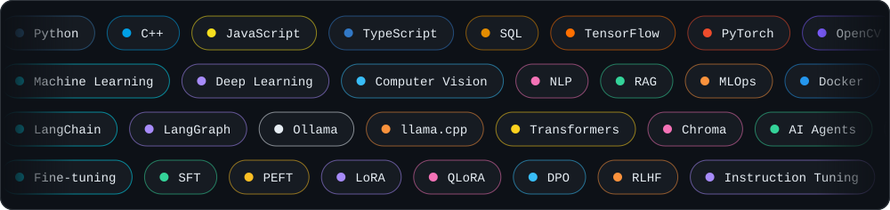
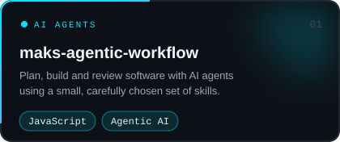
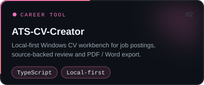
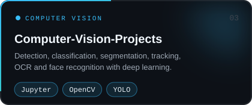
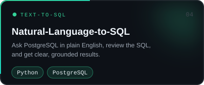
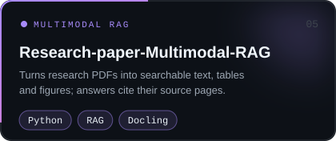
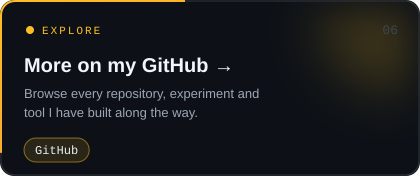

  

  
  
  
  

  

### 🧰 Toolbox

  

### 🚀 Featured Projects

  
  
  
  
  
  

### 🔭 At a Glance

| | |
|---|---|
| **🔨 Building now** | Multimodal RAG for research papers · Natural-language → SQL analytics · Agentic dev workflows |
| **🤖 AI Engineering** | AI agents · LLMs · RAG · orchestration · model deployment |
| **🧠 Training** | Machine Learning, National Telecommunication Institute (120+ hrs) · Competitive Programming, Coach Academy |
| **🏅 Certified** | Deep Learning Specialization · Machine Learning Specialization · Python 3 Programming |
| **💼 Open to** | ML Engineering · AI R&D · Computer Vision / NLP · MLOps · Software Engineering |

### 📊 Activity

  
  

  

  

<!-- 🐍 OPTIONAL: contribution snake. Add .github/workflows/snake.yml, run it once, then uncomment.

  <picture>
    <source media="(prefers-color-scheme: dark)" srcset="https://raw.githubusercontent.com/MakCoder-2004/MakCoder-2004/output/github-snake-dark.svg">
    
  </picture>

-->

  

